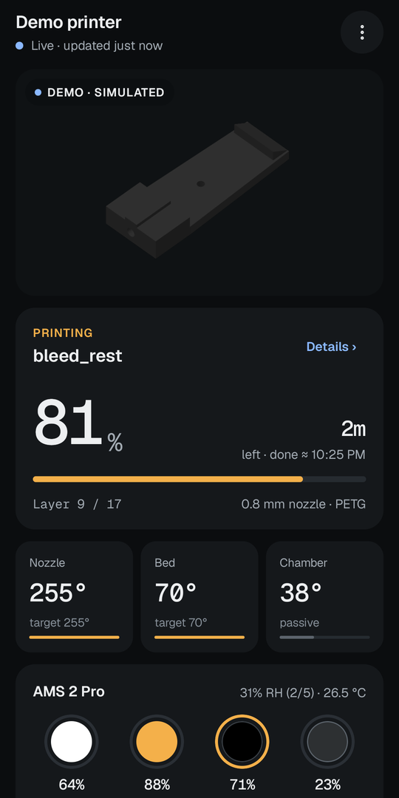
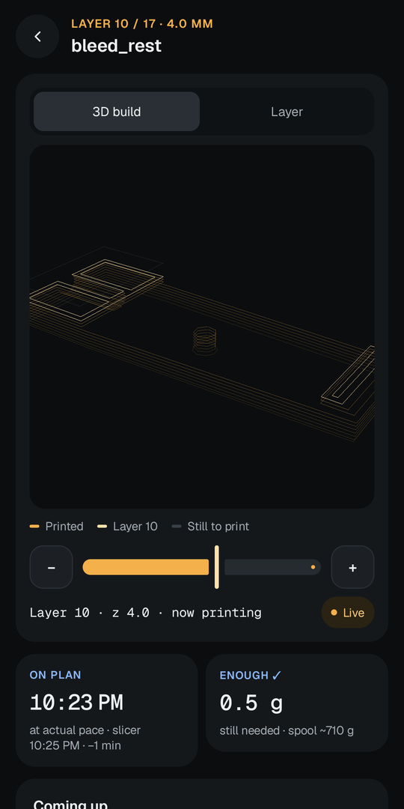
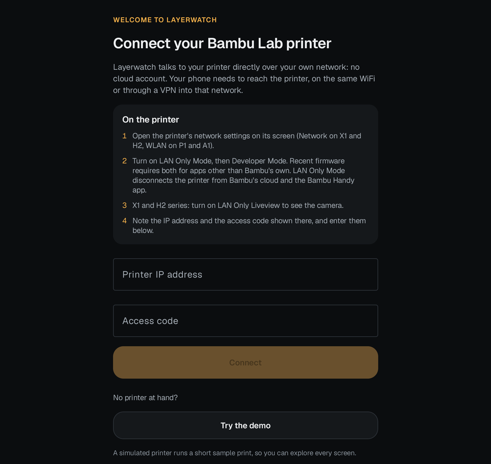

# Layerwatch

An Android app for watching and controlling Bambu Lab 3D printers over your own network.
No cloud account, no ads, no tracking: the phone talks to the printer directly.

<p>
  
  
  
</p>

## Features

- **Live camera.** H.264 over RTSPS on X1, P2S and H2 printers, with an adaptive buffer
  that rides out weak printer WiFi. Stills from the port-6000 camera on P1 and A1 printers.
- **Everything the printer reports.** Progress, layers, time left, temperatures, fans,
  AMS spools, humidity and drying status, and HMS alerts in plain English.
- **Controls with safety catches.** Chamber light, plus pause, stop and print speed. Pause
  and stop need a four-second press-and-hold, and speed changes must first be unlocked
  with a hold.
- **AMS drying.** Start and stop drying on an AMS 2 Pro or AMS HT, with the temperatures
  and times from Bambu Studio's filament profiles. Stopping takes a two-second hold.
- **Alerts with the phone locked.** While a print runs, a foreground service keeps
  watching after the app is closed:
  - Android 16 and later show a Live Update progress notification.
  - Failures, pauses, filament run-outs and the end of the print raise alerts, with a
    camera snapshot.
  - Watching stops when the print does, and nothing runs while the printer is idle.
- **Print details.** The job file is fetched from the printer to show:
  - a 3D cut-away of the toolpaths
  - a layer-by-layer view
  - which object is which
  - a finish-time forecast against the slicer's plan
  - upcoming features (bridges, top surfaces)
  - whether the loaded spools hold enough filament
  - the slicing settings
- **History and timelapses.** Finished prints with snapshots, and timelapse download and
  playback. Downloads keep going in the background.
- **Fits the device.** Phone, foldable (folded, unfolded, tabletop) and tablet layouts,
  plus a home-screen widget.
- **Demo mode.** A simulated printer, so you can try the app without one.

## Supported printers

| Series | Status |
|---|---|
| X1 Carbon | Developed and tested on this model |
| X1, X1E | Same protocol as the X1 Carbon; should work |
| P1P, P1S, A1, A1 mini, A2L | Supported from documented protocols; untested on hardware |
| P2S, H2D, H2D Pro, H2S, H2C, X2D | Supported from documented protocols; untested on hardware |

Dual-nozzle printers (H2D, H2C, X2D) show both nozzle temperatures. Reports from owners
of the untested models are very welcome: please open an issue.

## Setting up the printer

On the printer's own screen, open its network settings:

1. Turn on **LAN Only Mode**, then **Developer Mode**. Recent firmware accepts commands
   from apps other than Bambu's own only with both on. Without them, Layerwatch can still
   monitor, but pause, stop, speed and light are refused.

   LAN Only Mode disconnects the printer from Bambu's cloud and the Bambu Handy app.
2. On X1, P2S and H2 printers, turn on **LAN Only Liveview** for the camera.
3. Note the printer's **IP address** and **access code**, and enter them in Layerwatch.
   The app reads the serial number from the printer's certificate.

The phone must be able to reach the printer: on the same network, or from anywhere
through a VPN into that network (WireGuard, Tailscale and the like). Layerwatch is built
for that case. It notices dead connections quickly, reconnects when the phone changes
networks, and tells you whether the problem is the phone's connection or the printer.

## Privacy

- Layerwatch connects only to the printer you set up. It has no servers, analytics,
  advertising or crash reporting.
- The access code is encrypted with a key held in the Android Keystore.
- Every connection to the printer is TLS, checked against Bambu Lab's CA certificates
  (bundled with the app) and pinned to your printer's serial number.

## Building

Requirements:
- JDK 17
- Android SDK with platform 37

Gradle downloads everything else.

```sh
./gradlew :app:assembleDebug        # app/build/outputs/apk/debug/app-debug.apk
./gradlew :protocol:test            # protocol unit tests (JVM)
./gradlew :app:testDebugUnitTest    # app unit tests
```

The app needs Android 15 or later (minSdk 35).

**Live tests** run against a real printer. They are skipped unless these are set:

```sh
BAMBU_HOST=192.0.2.10 BAMBU_SERIAL=... BAMBU_CODE=... ./gradlew :protocol:test --tests '*Live*'
```

## Project layout

- `protocol/` is a plain Kotlin (JVM) library with no Android dependencies, covered by
  the unit tests. It contains:
  - a minimal MQTT 3.1.1 client
  - status parsing and event detection
  - an FTPS client (with the TLS session reuse the printer demands)
  - the JPEG camera stream
  - job-file and G-code parsing, forecasts
  - the demo printer
- `app/` is the Android app: Jetpack Compose UI, the monitoring service, notifications,
  the camera (Media3), the 3D view (OpenGL ES 3), the widget (Glance) and history.
- `tools/update_hms.py` refreshes the bundled HMS alert texts.

## Acknowledgements

- [OpenBambuAPI](https://github.com/Doridian/OpenBambuAPI) and
  [ha-bambulab](https://github.com/greghesp/ha-bambulab) documented much of what Bambu
  Lab printers speak on the LAN.
- HMS alert texts are published by Bambu Lab.
- The [Geist](https://vercel.com/font) fonts are used under the SIL Open Font License.

See [NOTICE](NOTICE) for details.

## License

Layerwatch is free software, licensed under the [GNU General Public License v3.0](LICENSE).

Layerwatch is an independent project, not affiliated with or endorsed by Bambu Lab.
"Bambu Lab" and printer model names are trademarks of their owners.
